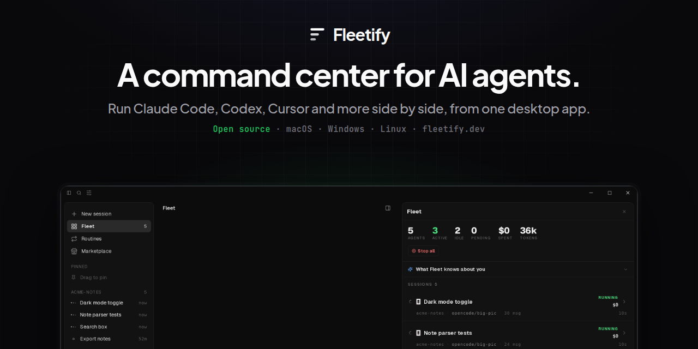

  

  <a href="https://fleetify.dev/download"><b>Download</b></a> ·
  <a href="https://github.com/fleetifydev/fleetify">Source</a> ·
  <a href="https://fleetify.dev/docs">Docs</a> ·
  <a href="https://fleetify.dev/changelog">Changelog</a> ·
  <a href="https://github.com/fleetifydev/fleetify/discussions">Discussions</a>

Fleetify is an open-source desktop app for running coding agents side by side. Start sessions with Claude Code, Codex, Cursor, GitHub Copilot, Google's Antigravity and other agent CLIs, or with API models, and follow them all from one Fleet hub: what each agent is doing, what it costs, and what is waiting for your approval.

| Repository | What it is |
|---|---|
| [**fleetify**](https://github.com/fleetifydev/fleetify) | The desktop app for macOS, Windows and Linux: Tauri 2, Rust and React, under Apache-2.0. |
| [**marketplace**](https://github.com/fleetifydev/marketplace) | The plugin catalog the app's Marketplace reads: MCP servers, skills and agent templates. |
| [**models**](https://github.com/fleetifydev/models) | The model catalog the app loads at runtime, so new models arrive without a release. |

**Contributing:** issues and pull requests are welcome. Start with [CONTRIBUTING.md](https://github.com/fleetifydev/fleetify/blob/main/CONTRIBUTING.md) and the [good first issues](https://github.com/fleetifydev/fleetify/issues?q=is%3Aissue%20is%3Aopen%20label%3A%22good%20first%20issue%22). Report security issues privately through [GitHub's vulnerability reporting](https://github.com/fleetifydev/fleetify/security/advisories/new).

Follow along on [X](https://x.com/fleetify_dev) and [LinkedIn](https://www.linkedin.com/company/fleetifyai).
